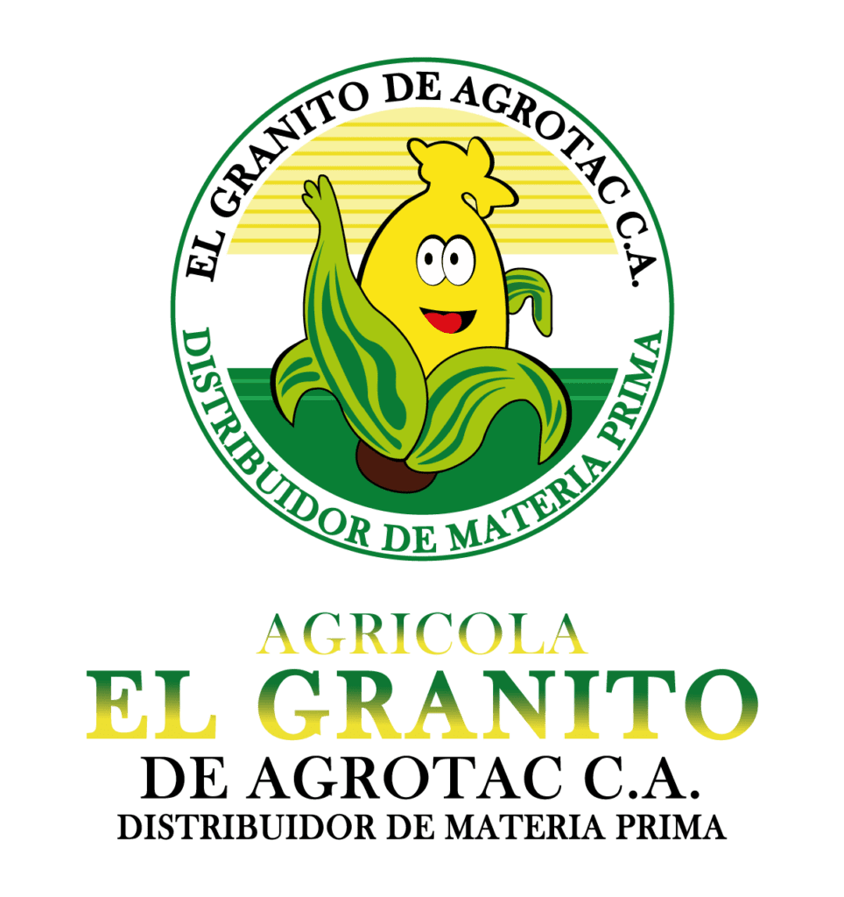
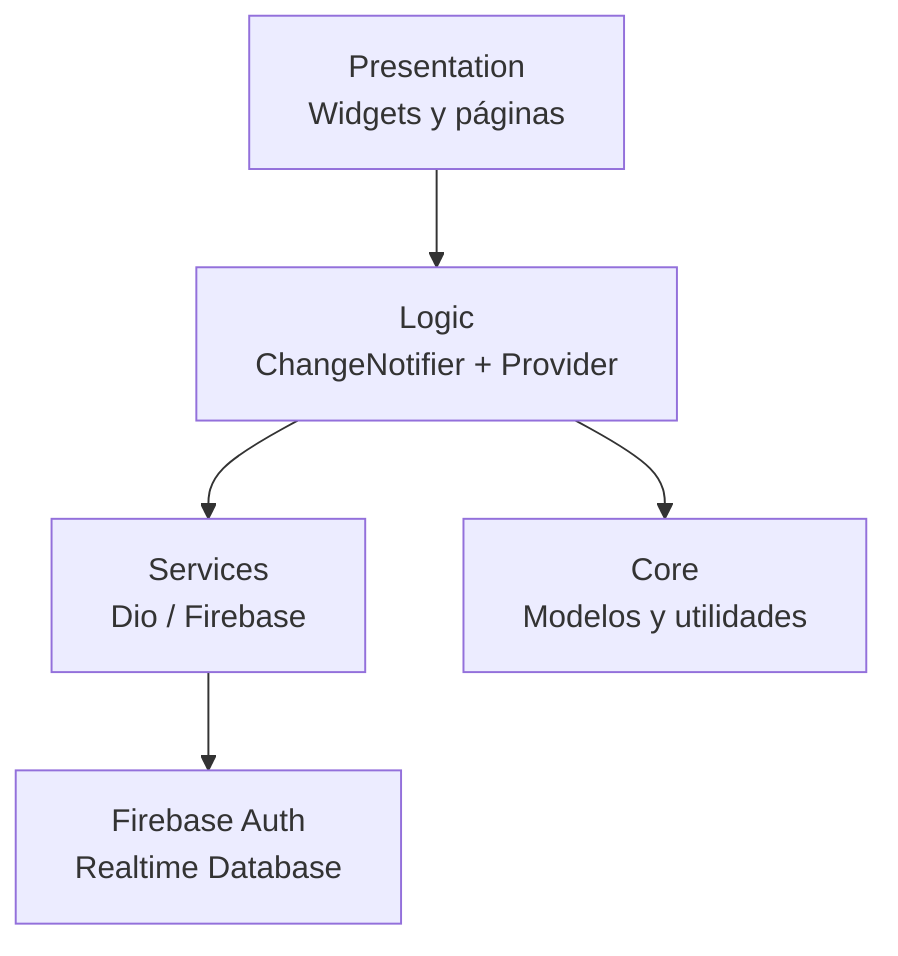

<p align="center">
  
</p>

<h1 align="center">Diprovet · Cliente móvil</h1>

<p align="center">
  Catálogo, carrito y notas de pedido para <strong>Agrícola El Granito</strong>.
</p>

<p align="center">
  
  
  
  
</p>

## Descripción

Aplicación móvil Flutter para que los clientes de Diprovet consulten productos
veterinarios y agrícolas, armen un carrito y compartan una nota de pedido. La
autenticación y el catálogo se apoyan en Firebase.

> **Estado:** MVP funcional en desarrollo activo. El catálogo se lee de Firebase
> Realtime Database, el carrito vive en memoria y la nota de pedido se comparte
> como imagen (todavía no se persiste en el backend).

## Características

- Inicio de sesión y registro con Firebase Authentication (correo y contraseña).
- Sesión persistente y protección de rutas privadas.
- Catálogo por categorías con animaciones Lottie.
- Búsqueda visual de productos con imagen, precio y presentación.
- Carrito con cantidades, totales y actualización en tiempo real.
- Nota de pedido capturada como imagen y compartida desde el dispositivo.
- Manejo de errores de red y de autenticación con mensajes en español.
- Formato de moneda localizado (`$ 12.500,00`).

## Stack

| Área | Tecnología |
| --- | --- |
| Framework | Flutter 3.47.6 / Dart 3.13 |
| Estado | [`provider`](https://pub.dev/packages/provider) + `ChangeNotifier` |
| Navegación | [`go_router`](https://pub.dev/packages/go_router) |
| Red | [`dio`](https://pub.dev/packages/dio) |
| Backend | Firebase Authentication + Realtime Database |
| Resultados | [`dartz`](https://pub.dev/packages/dartz) (`Either`) |
| UI | Material 3, [`lottie`](https://pub.dev/packages/lottie) |
| Nota de pedido | [`screenshot`](https://pub.dev/packages/screenshot) + [`share_plus`](https://pub.dev/packages/share_plus) |
| Calidad | [`very_good_analysis`](https://pub.dev/packages/very_good_analysis) |

## Requisitos

- **Flutter 3.47.6** (ver [`.fvmrc`](.fvmrc)) y Dart 3.13.
- Android SDK para compilar en Android.
- macOS + Xcode + CocoaPods para compilar en iOS.
- Una conexión a internet para Firebase y el catálogo.

El proyecto usa [`FVM`](https://fvm.app/) para fijar la versión de Flutter. Si no
lo usas, asegúrate de tener instalada una versión **≥ 3.27** (el código usa APIs
como `Color.withValues`).

## Inicio rápido

```bash
git clone https://github.com/ErickVera1997/Flutter-Diprovet.git
cd Flutter-Diprovet

# Opción recomendada: FVM
fvm install
fvm flutter pub get
fvm flutter run

# Opción con Flutter global
flutter pub get
flutter run
```

Comprueba el entorno con `flutter doctor -v` antes de compilar.

### Configuración de Firebase

El repositorio ya incluye la configuración del proyecto de Firebase
`flutter-varios-38eb4`:

- `lib/firebase_options.dart`
- `android/app/google-services.json`
- `ios/Runner/GoogleService-Info.plist`

Para ejecutar la app con ese proyecto no necesitas pasos adicionales. Si vas a
usar **tu propio proyecto** de Firebase, habilita Email/Password, genera la
configuración con FlutterFire CLI y revisa las reglas de Realtime Database:

```bash
dart pub global activate flutterfire_cli
flutterfire configure --project=<tu-proyecto>
```

Los detalles, el esquema de datos y reglas de ejemplo están en
[`docs/FIREBASE.md`](docs/FIREBASE.md).

## Comandos útiles

| Tarea | Comando |
| --- | --- |
| Instalar dependencias | `fvm flutter pub get` |
| Ejecutar la app | `fvm flutter run` |
| Análisis estático | `fvm flutter analyze` |
| Pruebas | `fvm flutter test` |
| Formatear | `dart format lib test` |
| Verificar formato en CI | `dart format --set-exit-if-changed lib test` |
| Build Android | `fvm flutter build apk --release` |
| Build iOS | `fvm flutter build ios --release` |

> Las plataformas soportadas son **Android e iOS**. `firebase_options.dart` no
> está configurado para web, macOS, Windows ni Linux.

## Estructura del proyecto

```text
lib/
├── core/
│   ├── models/                 # Product, Category, Detail
│   ├── dio_interceptors.dart   # Cabeceras JSON y timeouts
│   ├── routes.dart             # Rutas y guard de sesión
│   └── utils.dart              # Formato de moneda y decoraciones
├── logic/                      # ChangeNotifiers (estado de la app)
│   ├── authentication_provider.dart
│   ├── products_provider.dart
│   └── shopping_provider.dart
├── services/                   # Acceso a Firebase y API
│   ├── authentication_service.dart
│   └── products_service.dart
├── presentation/
│   ├── autentication/          # Splash, login y registro
│   ├── products/               # Listado y detalle de producto
│   ├── shopping/               # Carrito y nota de pedido
│   ├── widgets/                # Botones, inputs, alertas y overlays
│   ├── home_page.dart
│   ├── my_app.dart
│   └── screens.dart
├── firebase_options.dart       # Generado por FlutterFire CLI
└── main.dart
assets/                         # Imágenes y animaciones Lottie
docs/                           # Arquitectura, Firebase y contribución
test/                           # Pruebas unitarias y de widgets
```

> La carpeta `presentation/autentication` conserva un nombre histórico. Se
> mantiene para no romper imports; está previsto renombrarla a `authentication`.

## Arquitectura

La app sigue una separación simple por capas:



- **Presentation** solo pinta y dispara acciones; no conoce detalles de red.
- **Logic** expone estado inmutable y notifica cambios con `ChangeNotifier`.
- **Services** encapsulan Firebase/Dio y devuelven `Either<String, T>`.
- **Core** contiene modelos tolerantes a datos incompletos y utilidades.

Los providers se registran una sola vez en `lib/presentation/my_app.dart`:
`AuthenticationProvider`, `ProductsProvider` y `ShoppingProvider`.

### Rutas

| Ruta | Pantalla | Acceso |
| --- | --- | --- |
| `/` | Splash / inicio | Público |
| `/login-or-register` | Login y registro | Público |
| `/home` | Catálogo con pestañas | Privado |
| `/products` | Listado alternativo (legacy) | Privado |
| `/products-details` | Detalle (requiere `ProductDetailPageArg`) | Privado |
| `/shopping` | Carrito | Privado |
| `/cart-shopping` | Nota de pedido | Privado |

Si no hay sesión, el guard redirige las rutas privadas a `/`. Más detalles en
[`docs/ARCHITECTURE.md`](docs/ARCHITECTURE.md).

## Estado actual y limitaciones

- El carrito se pierde al cerrar la app (no hay persistencia local).
- La nota de pedido se comparte como imagen; no se guarda en Firebase.
- Las presentaciones del detalle (`3 ml`, `18 ml`) y el código son datos de
  maqueta.
- `ProductsPage` y `card_detail_product.dart` son código heredado sin uso.
- No hay localización (`l10n`), modo offline ni paginación.
- El `applicationId` de Android sigue siendo `com.example.flutter_diprovet_cliente`.
- El checkbox **“Recordar contraseña”** aún no tiene funcionalidad.

Las tareas pendientes están en el [roadmap](#roadmap).

## Calidad y pruebas

```bash
fvm flutter analyze   # 0 issues
fvm flutter test      # suite en verde
dart format --set-exit-if-changed lib test
```

La suite cubre:

- Parseo tolerante de `Product` (campos ausentes, tipos inesperados).
- Reglas del carrito: cantidades, productos homónimos, totales y limpieza.
- Carga, filtrado por categoría, recarga y errores del catálogo.
- Formato de moneda.
- Comportamiento básico de widgets reutilizables.

Convenciones y checklist de PR en
[`docs/CONTRIBUTING.md`](docs/CONTRIBUTING.md).

## Solución de problemas

| Síntoma | Causa / solución |
| --- | --- |
| `The method 'withValues' isn't defined` | Flutter < 3.27. Ejecuta `fvm install` y usa `fvm flutter`. |
| `DefaultFirebaseOptions have not been configured for web` | La app solo está configurada para Android/iOS. |
| `[core/no-app] No Firebase App` | Verifica que `Firebase.initializeApp` se ejecute en `main.dart`. |
| Falla `pod install` en iOS | `cd ios && pod repo update && pod install` (mínimo iOS 13). |
| `uses-sdk` o paquete incorrecto en Android | El paquete está registrado como `com.example.flutter_diprovet_cliente`; cambiarlo exige actualizar Firebase y `google-services.json`. |
| No encuentra un asset | Revisa que la carpeta esté declarada en `pubspec.yaml` y reinicia la app. |
| El symlink `.fvm/flutter_sdk` está roto | `.fvm/` es local; ejecuta `fvm use 3.47.6`. |

## Roadmap

- [x] Autenticación, catálogo, carrito y nota de pedido.
- [x] Manejo de errores de red y autenticación.
- [x] Tests de modelos, providers y widgets.
- [ ] Persistir el carrito entre sesiones.
- [ ] Guardar pedidos en el backend.
- [ ] Presentaciones y códigos reales desde Firebase.
- [ ] Eliminar/reutilizar `ProductsPage` y `card_detail_product.dart`.
- [ ] Implementar o retirar “Recordar contraseña”.
- [ ] Escuchar la expiración de sesión en el router.
- [ ] Unificar `applicationId` Android/iOS.
- [ ] Actualizar Firebase, `go_router` y `share_plus`.
- [ ] Localización, accesibilidad y modo offline.
- [ ] CI con `analyze`, `test` y cobertura.

## Contribuir

1. Crea una rama desde `develop`: `feat/mi-cambio`, `fix/mi-correctivo` o
   `docs/mi-documentacion`.
2. Mantén el estilo de `very_good_analysis` (80 columnas, `const`, comas
   finales).
3. Añade o actualiza pruebas cuando cambies lógica.
4. Ejecuta `flutter analyze`, `flutter test` y `dart format`.
5. Abre el PR siguiendo [`docs/CONTRIBUTING.md`](docs/CONTRIBUTING.md).

## Licencia

Este repositorio no incluye un archivo de licencia. Consulta con el equipo de
Diprovet antes de reutilizar el código fuera del proyecto.
