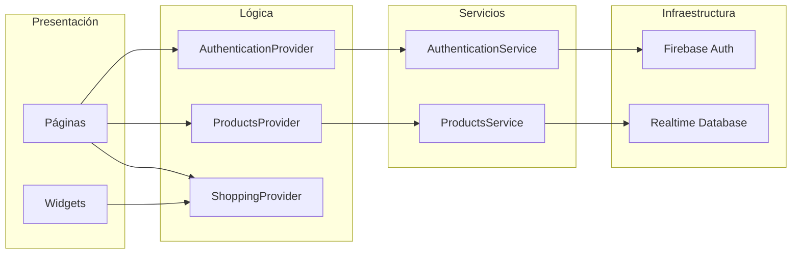

# Arquitectura

Documento de referencia para entender cómo está organizado el cliente móvil de
Diprovet y por qué se tomaron ciertas decisiones.

## Visión general



La aplicación no usa una arquitectura hexagonal estricta. Se eligió una
separación por capas deliberadamente simple para un MVP:

| Capa | Carpeta | Responsabilidad |
| --- | --- | --- |
| Presentación | `lib/presentation` | Widgets, navegación y feedback al usuario |
| Lógica | `lib/logic` | Estado de la app y reglas de negocio |
| Servicios | `lib/services` | Acceso a Firebase/Dio y traducción de errores |
| Núcleo | `lib/core` | Modelos, rutas, utilidades y configuración de red |

## Flujo de datos

### Carga del catálogo

1. `MyApp` registra `ProductsProvider` una sola vez.
2. El constructor llama a `loadProducts()`.
3. `ProductsService` consulta Realtime Database con Dio.
4. Cada mapa se convierte con `Product.fromMap`, que tolera campos ausentes.
5. `ProductsProvider` aplica el filtro de la categoría seleccionada y notifica.
6. `HomePage` escucha con `context.watch` y repinta.

Si la carga falla, el provider expone `errorMessage` y el home muestra un botón
para reintentar. Los errores de red no se confunden con un catálogo vacío.

### Carrito

- `ShoppingProvider` guarda una lista de `Detail` (producto + cantidad).
- La identidad del producto se resuelve por `product.id`; si viene vacío, se usa
  el nombre como respaldo.
- `addProduct` incrementa cantidades existentes; `setQuantity` reemplaza;
  `decrementAmount` elimina el ítem cuando llega a cero.
- `details`, `productsCount` y `total` son de solo lectura desde la UI.
- El carrito vive en memoria: se pierde al cerrar la app y se limpia al cerrar
  sesión.

### Autenticación

- `AuthenticationService` encapsula Firebase Auth y traduce
  `FirebaseAuthException` a mensajes en español.
- `AuthenticationProvider` centraliza `isLoading` y las tres operaciones:
  registro, inicio y cierre de sesión.
- Ambos providers viven en la raíz de la app (`my_app.dart`), no por pantalla.
- `routes.dart` protege las rutas privadas consultando
  `FirebaseAuth.instance.currentUser`.

## Manejo de errores

Los servicios devuelven `Either<String, T>` de `dartz`:

```dart
final result = await productService.fetchProducts();
result.fold(
  (message) => showError(message),
  (products) => render(products),
);
```

Convenciones:

- El mensaje de la izquierda es apto para mostrarse al usuario.
- Los detalles técnicos se registran con `debugPrint`.
- La UI nunca hace `!` sobre datos que puedan faltar.
- Los modelos usan valores por defecto en lugar de lanzar excepciones.

## Navegación

`go_router` centraliza las rutas en `lib/core/routes.dart`. Cada página declara
su `routeName` como constante.

- `/` y `/login-or-register` son públicas.
- El resto exige sesión; si no existe, el guard redirige a `/`.
- `ProductDetailPage` recibe su argumento por `state.extra`. Si falta, vuelve al
  home en lugar de lanzar una excepción.
- Las rutas desconocidas muestran una pantalla de error con enlace al inicio.

Para redirigir automáticamente cuando Firebase invalide la sesión, el siguiente
paso es añadir un `refreshListenable` al router que escuche
`FirebaseAuth.instance.authStateChanges()`.

## Dinero y formato

`lib/core/utils.dart` expone `formatCurrency`, basado en `intl` con locale
`es_CO`:

```dart
formatCurrency(12500.5); // $ 12.500,50
```

Se usa en home, listado, detalle, carrito y nota de pedido para evitar formatos
inconsistentes (`10.0` vs `10,00`).

## Red

`DioInterceptors` añade las cabeceras JSON. En `my_app.dart` se configura un
`Dio` con timeouts de 15 segundos, para que una red lenta no deje la UI
bloqueada indefinidamente.

La URL del catálogo está en `ProductsService`:

```text
https://flutter-varios-38eb4-default-rtdb.firebaseio.com/products.json
```

Moverla a configuración por entorno es una mejora pendiente.

## Pruebas

| Tipo | Ubicación | Qué cubre |
| --- | --- | --- |
| Unidad | `test/core` | Parseo de modelos y formato de moneda |
| Unidad | `test/logic` | Catálogo, filtros, carrito y totales |
| Widget | `test/presentation` | Comportamiento de widgets reutilizables |

`ProductsProvider` acepta `autoLoad: false` para poder inyectar un servicio falso
y probar la carga de forma determinista.

## Deuda técnica conocida

| Tema | Ubicación | Propuesta |
| --- | --- | --- |
| Carpeta `autentication` mal escrita | `lib/presentation/autentication` | Renombrar a `authentication` y actualizar imports |
| `ProductsPage` sin enlace | `lib/presentation/products/products_page.dart` | Reutilizar desde el home o eliminar |
| Widget sin uso | `lib/presentation/products/widget/card_detail_product.dart` | Eliminar o integrar en el detalle |
| Datos simulados | `product_details_page.dart` | Leer presentaciones/código del backend |
| Categorías hardcodeadas | `products_provider.dart` | Derivarlas del catálogo o de Firebase |
| Carrito en memoria | `shopping_provider.dart` | Persistir con Hive/SharedPreferences |
| Pedido no persistido | `cart_shopping_page.dart` | Guardar la orden en Realtime Database |
| `applicationId` de ejemplo | `android/app/build.gradle` | Unificar con el bundle id de iOS |
| Dependencias antiguas | `pubspec.yaml` | Planificar migración de Firebase, go_router y share_plus |
| Sin localización | Toda la UI | Introducir `flutter_localizations` y ARB |

## Decisiones

- **Provider en lugar de Riverpod/Bloc:** el equipo ya lo usaba y el tamaño del
  MVP no justifica una migración.
- **`Either` en servicios:** evita excepciones no controladas en la UI y hace
  explícito el camino de error.
- **Sin generación de código:** los modelos son pequeños; `fromMap` escrito a
  mano reduce dependencias y tiempos de build.
- **Firebase Realtime Database:** ya estaba en producción; no se migró a
  Firestore para no ampliar el alcance.
